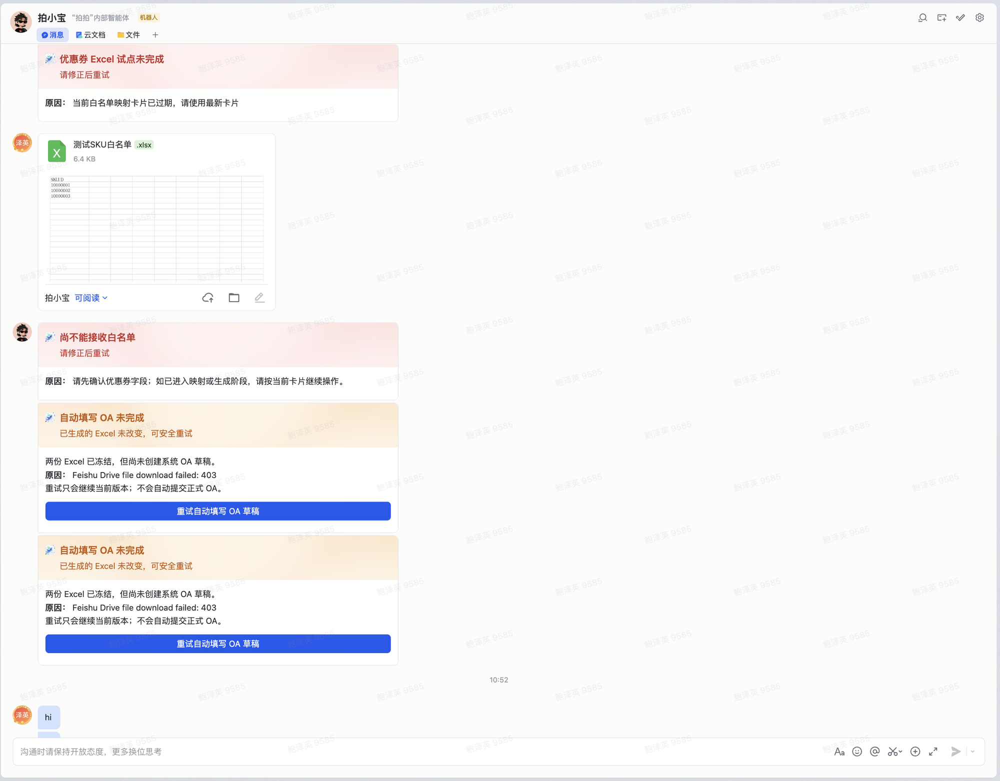

# aihuishou Feishu Workflow

爱回收飞书工作流项目。该工程从原 Slack/Notion 项目提炼业务能力后形成独立目标项目，不与源系统共用部署、凭证或数据源。

## 项目结构

```text
.
├── .env.example                  # 环境变量示例
├── apps/
│   └── miaoda-admin/              # 妙搭管理员前端（独立 Vite 包）
├── biome.json                    # Biome 代码检查与格式化配置
├── docs/                         # 架构与迁移文档
│   ├── adr/                      # 架构决策记录（ADR）
│   ├── architecture-decision.md  # 当前 POC 架构基线
│   └── future-technology-selection.md # 后续技术选型决策
├── miaoda-auth.png               # 妙搭认证示意图
├── nitro.config.ts               # Nitro 配置
├── package.json                  # 项目依赖和脚本
├── pnpm-lock.yaml                # pnpm 锁文件
├── scripts/                      # 运维与集成脚本
│   ├── inject-edge-callback.mjs  # 注入边缘回调
│   └── long-connection-bridge.mjs # 长连接桥接
├── server/                       # 服务端业务代码
│   ├── api/
│   │   └── feishu/
│   │       └── process.post.ts   # 飞书流程处理接口
│   ├── lib/
│   │   ├── feishu/               # 飞书客户端、事件与报销 POC
│   │   ├── health.ts             # 健康检查逻辑
│   │   └── health.test.ts        # 健康检查测试
│   └── routes/
│       └── index.get.ts          # 根路由
├── tsconfig.json                 # TypeScript 配置
└── vercel.json                   # Vercel 部署配置
```

> `.nitro/`、`.output/` 和 `.vercel/` 是本地生成的类型、构建或部署产物，未列入上述源码结构；`.env.local` 用于本地私密配置，不应提交到版本控制。

## POC 范围

- POC 测试成员不超过 10 人，使用 Vercel Hobby（免费版）和测试数据；后续首批正式上线预计约 30 人，届时切换至付费正式版本或企业批准的执行环境。
- 管理员通过妙搭工作台配置、保存草稿并发布报销模板；模板和实例继续以飞书 Base 为 POC 数据源
- 员工通过飞书机器人调用已发布模板
- 提交后进入审批人处理队列
- 申请人和管理员可以追踪审批状态及日志
- 每个实例固定绑定发起时的模板版本

## 优惠券 Excel 内网试点（P1-1）

试点入口为 Bot 单聊中的 `优惠券Excel试点`。它只支持“常规满减券 + 单列 SKUID 白名单”：确认生成结果后形成**系统 OA 草稿**并冻结两份受控 Excel。`draft-only` 首发只保存 Drive/Base 引用、hash 与草稿状态；进入原生 OA canary 前，现有审批附件提升逻辑必须改为最终门禁后的即时提升。Excel 流程自身绝不自动确认或提交正式 OA。

> **上线边界**：本地 `pnpm dev:events` 仅用于调试。内网首发必须使用企业托管、常驻且受监督的长连接 bridge，经已签名的请求将事件交给 Vercel/Nitro。首发为 `draft-only`，严禁调用原生 OA 创建 API；仅在 [rollout](docs/oa-ticket-reimbursement-materials/current/operations/coupon-oa-internal-pilot-rollout-plan-v1.md) 的原生 OA Gate 全部通过后，才可向严格服务端 allowlist 开放 canary。该例外不取代 [ADR-0002](docs/adr/0002-use-http-callback-as-event-ingress.md) 的长期 HTTP callback 目标。

启用前需准备：

1. 在现有 Base App 中创建**独立**的「优惠券 Excel 试点草稿」表，不得复用 `FEISHU_COUPON_DRAFT_TABLE_ID` 指向的 OA 草稿表；字段需与 `excel-pilot-store.ts` 中的 `recordFields()` 对应，特别是附件类型字段 `Generated Coupon File`、`Generated Whitelist File` 和长文本字段 `OA Handoff JSON`。
2. 创建供应用身份写入的飞书 Drive 文件夹，记录文件夹 token。
3. 为 R2 开通 Base 读写、消息资源下载和 Drive 文件上传/下载并发布应用版本；审批附件上传、原生 instance create/get 仅在 R3 原生 OA Gate 前以隔离定义/测试用户完成权限验证。
4. 在 Vercel 环境变量中设置 `FEISHU_COUPON_EXCEL_PILOT_ENABLED=true`、试点表 ID、Drive 文件夹 token 和 `DEEPSEEK_API_KEY`；上线环境还必须通过 rollout 要求的显式 fail-closed stage/allowlist/kill switch 改造，不能只依赖这些变量。

生成结果会上传到该 Drive 文件夹，并同时附加到系统自有的 Base 试点草稿。源白名单绝不会上传到审批附件库。寄卖/pop 仍须由业务员手动上传满减测算图片；在 `draft-only` 阶段，用户只会看到草稿/补件/核对结果。只有 rollout 的 native-submit Gate 通过后，当前 revision 的最终确认才可按受控路径上传批准附件并创建、回读原生 OA。

### 试点失败反馈与安全重试样例

下图为用户提供的、仅含测试数据的飞书 Bot 对话记录。它展示了三类可恢复反馈：映射确认卡过期、白名单暂不能接收，以及 Drive 下载返回 `403` 后系统 OA 草稿未完成。前两种情况必须在最新卡片中修正后继续；最后一种可以安全重试。**两份 Excel 冻结不等于 OA 已创建，更不等于正式 OA 已提交。**



截图中可见的“测试SKU白名单”已作为可下载、脱敏的 [Excel 示例文件](docs/oa-ticket-reimbursement-materials/reference/fixtures/excel-pilot-retry-evidence/测试SKU白名单.xlsx) 上传；它仅含 `SKUID` 列和三个测试值。原始附件没有随截图提供，因此仓库版本是根据可见内容重建的样例，而不是原始文件的二进制副本。完整的证据边界、校验和与场景说明见 [重试反馈 fixture](docs/oa-ticket-reimbursement-materials/reference/fixtures/excel-pilot-retry-evidence/README.md)。

## 优惠券 OA 文档库

产品需求、实施方案、模板调研、脱敏演练和本地案例的数据边界统一见[优惠券 OA 文档库](docs/oa-ticket-reimbursement-materials/README.md)。P1-1 在保留其受限 Excel 生成范围的同时，将确认后的两份输出接入既有系统 OA 草稿；`draft-only` 阶段不创建原生 OA，后续服务端创建必须遵循当前 revision、明确确认、allowlist、幂等与回读门禁。

## 项目边界

- 源系统：原 Slack/Notion 项目，仅用于功能对照
- 目标系统：本工程 + 飞书自建应用 + 独立 Base
- 部署项目：独立的 `aihuishou-feishu-workflow`，禁止复用原项目
- 数据策略：POC 不迁移历史生产数据，只使用测试记录

## 当前资源

- Base：[爱回收 Workflow POC](https://atrenew.feishu.cn/base/KXJzbs2HeaCeifsOdbpcT9j9nMh)
- 模板表：`tbl9a8myAri73miH`
- 实例表：`tblV3RiNvQlpRJ3F`

现有 Base 可作为结构样板；正式爱回收环境建议复制为独立 Base，并重新确认所有者、可见范围和审批人。

## 妙搭管理员控制台

`apps/miaoda-admin/` 是与 Nitro 服务同仓维护、但独立构建和部署到妙搭的管理员前端。它只提供三类管理能力：

- **运行总览**：查看已发布模板、流程状态和最近实例；
- **报销模板**：保存草稿、配置当前飞书卡片支持的四个报销字段并发布新版本；
- **流程实例**：按审批状态查询由飞书机器人创建的实例。

员工发起报销和审批人通过/驳回仍只在飞书消息与交互卡片中完成。管理端不拥有独立数据库，所有模板、实例和审批结果均通过 Nitro 管理 API 读写同一份飞书 Base POC 数据。

### 本地开发

```bash
cp .env.example .env.local
pnpm dev                 # Nitro API，默认 http://localhost:3000
pnpm dev:admin           # 妙搭管理端，默认 http://localhost:5173
```

`pnpm dev` 会自动加载项目根目录的 `.env.local`。优惠券 OA 草稿联调前，
先运行 `zsh scripts/check-coupon-oa-local-draft-demo.sh`，确认当前模式为
`draft-demo`。

为管理端另建 `apps/miaoda-admin/.env.local`：

```bash
VITE_ADMIN_DEV_OPEN_ID=ou_replace_with_test_admin
# VITE_ADMIN_API_BASE_URL=  # 本地 Vite 代理时留空
```

`ADMIN_AUTH_MODE=development` 仅允许非生产环境使用，且 `X-Admin-Open-Id` 必须属于 `ADMIN_DEV_OPEN_IDS`。生产环境会对此模式 fail closed；部署到妙搭前必须改为可验证的妙搭/飞书实际操作者身份，并由服务端复核管理员权限。浏览器端环境变量中不得放入飞书密钥、Base token 或服务器管理密钥。

构建与校验：

```bash
pnpm lint
pnpm typecheck
pnpm test
pnpm build
pnpm build:admin
```

## 架构文档

- [当前 POC 与优惠券内网试点架构基线 v1.1](docs/architecture-decision.md)：当前已采用的飞书 + 妙搭 + Vercel + Base 架构，以及企业托管 bridge 的受限试点边界。
- [后续技术选型决策](docs/future-technology-selection.md)：内网试点例外登记，以及生产云、数据库、队列、日志、对象存储及 AI/Agent 的待决策项。
- [跨产品需求排期 Backlog](docs/requirements-backlog.md)：记录已确认但尚未排入当前交付范围的跨产品需求；当前包含优惠券 OA 的身份映射与配券节奏表 API 候选。
- [ADR-0001：分阶段混合架构](docs/adr/0001-adopt-phased-hybrid-architecture.md)
- [ADR-0002：HTTP 回调事件入口](docs/adr/0002-use-http-callback-as-event-ingress.md)
- [ADR-0003：妙搭控制面与 Vercel 执行面](docs/adr/0003-separate-miaoda-control-plane-and-vercel-execution-plane.md)
- [ADR-0004：系统草稿与确认即提交](docs/adr/0004-bot-confirmed-submit-for-coupon-oa.md)
- [ADR-0006：企业托管长连接内网试点](docs/adr/0006-use-managed-long-connection-bridge-for-internal-coupon-pilot.md)

当前 POC 的架构边界变更必须新增 ADR；后续技术选择先在“后续技术选型决策”中完成评估，若改变职责边界、事实源、事件入口或正式部署平台，也必须新增 ADR。
