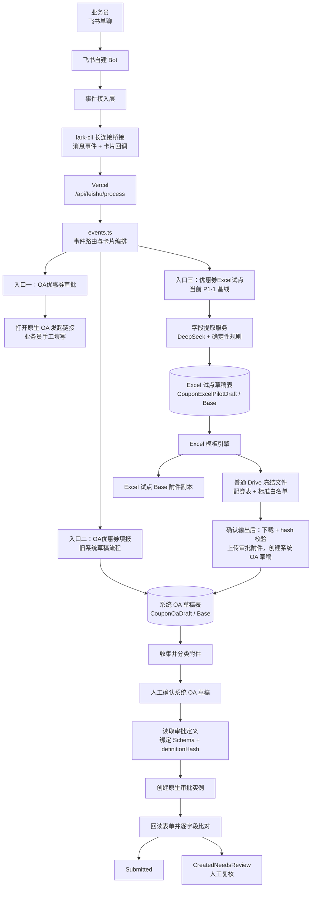
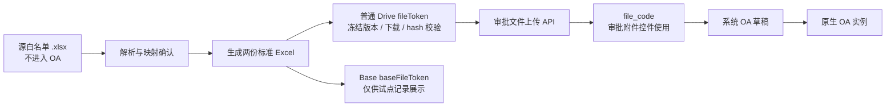

# 优惠券 OA 当前功能结构与重构基线 v1

> **状态**：持续维护的技术基线；用于指导后续迭代与重构拆分
> **版本**：v1.0
> **建立日期**：2026-10-08
> **代码快照**：`main` / `45ae50f feat: add coupon Excel pilot workflow`
> **适用范围**：飞书 Bot、优惠券 Excel 试点、系统 OA 草稿、飞书原生审批提交，以及它们之间的文件与状态交接
> **不替代**：[P1 Excel 试点 PRD v1.5](../product/coupon-oa-p1-excel-pilot-prd-v1.5.md) 的产品范围，也不将[对话式一轮确认改造 PRD](../../proposals/conversational-single-confirm/coupon-oa-conversational-single-confirm-prd-v1.3.md)视为已获批实现。

## 1. 文档目的与使用规则

本文件记录**当前代码已实现的结构**、已验证的运行边界、已知阻塞，以及后续重构的目标和顺序。后续需求、实现与架构决策应以此作为技术对照基线。

### 1.1 文档权威性

| 问题类型 | 以什么为准 |
| --- | --- |
| 当前 P1-1 支持范围、业务字段、验收条件 | [P1 Excel 试点 PRD v1.5](../product/coupon-oa-p1-excel-pilot-prd-v1.5.md) |
| 已写入代码的当前结构、模块职责、已知技术债 | **本文件** |
| 一轮确认交互的目标方案 | [对话式一轮确认改造 PRD](../../proposals/conversational-single-confirm/coupon-oa-conversational-single-confirm-prd-v1.3.md)，获批前不得改变当前基线 |
| OA 权限、确认即提交的平台约束 | [ADR-0004](../../../adr/0004-bot-confirmed-submit-for-coupon-oa.md) |
| 单次环境故障、复测证据 | `operations/diagnostics/` 下对应的日期化诊断文档 |

### 1.2 后续迭代约定

1. 新功能先标注其落点：现有入口、现有状态机、还是新增状态机；不得在没有归属的情况下直接往事件处理器增加分支。
2. 改动用户入口、事实源、审批提交时机、文件归属或责任边界时，先更新本文件；如改变架构边界，另建 ADR。
3. 产品规则变化先修改 PRD；本文件只描述落地结构、迁移策略和技术约束。
4. 每次合并影响结构的代码后，更新第 8 节的模块映射、第 10 节的待办状态和第 12 节的变更记录。

---

## 2. 当前结论

当前系统已具备“**飞书 Bot 采集 → 生成受控 Excel → 系统 OA 草稿 → 原生 OA 提交与回读**”的主要代码能力，但它仍处于 P1-1 内网试点阶段。

- P1-1 的主入口是 `优惠券Excel试点`，支持常规满减券和单列 `SKUID` 白名单。
- 原生 OA 并非可写入的飞书客户端草稿。系统先把待确认数据存入自有的飞书 Base 系统草稿，用户最终确认后才创建原生审批实例。
- Excel 试点生成、普通 Drive 冻结文件写入、Excel 试点 Base 附件写入已实际验证。
- 已知运行阻塞是：确认生成结果后，应用下载 Drive 冻结文件时返回 HTTP 403，导致“Excel 试点 → 系统 OA 草稿”的真实联调尚未完成。详见[Drive 下载 403 诊断](../../records/diagnostics/coupon-excel-pilot-drive-download-403-resolution-2026-09-30.md)。
- 当前存在三个并行入口、两张草稿表和一次跨流程交接；这在试点期可接受，但一轮确认方案若获批，必须先做结构收敛，不能继续向现有总路由叠加分支。
- **待评审的三源流程**将新增“任意布局配券表 + 必传白名单 + 可选黑名单”来源、第一次业务决策确认和第二次原生 OA 发起确认。它必须采用独立触发口令、专用存储和功能开关，并保持与当前 P1-1 及旧草稿路径互斥；详见[三源优惠券 OA 填报 PRD](../../proposals/three-source/coupon-oa-three-source-workflow-prd-v1.md)与[ADR-0005](../../../adr/0005-three-source-coupon-workflow.md)。正式白名单/黑名单模板和字段映射未登记前，该路径不得启用。

---

## 3. 系统全景结构



### 3.1 运行时事件链路

```text
飞书消息 / 卡片回调
  → lark-cli event consume（本地 WebSocket）
  → POST /api/feishu/process（Vercel）
  → handleFeishuPocEvent()
  → 相应流程服务
  → 飞书消息 API 回发交互卡片
```

- 桥接消费 `im.message.receive_v1` 与 `card.action.trigger`，实现位于 [`scripts/long-connection-bridge.mjs`](../../../../scripts/long-connection-bridge.mjs)。
- HTTP 入口位于 [`server/api/feishu/process.post.ts`](../../../../server/api/feishu/process.post.ts)。
- 事件总路由位于 [`server/lib/feishu/events.ts`](../../../../server/lib/feishu/events.ts)。
- 飞书 API 调用统一通过应用身份的 `tenant_access_token`；凭证只应保存在服务器环境变量中。

> 运维约束：若本地长连接桥接是当前 Bot 的事件入口，则桥接进程必须常驻；Vercel 服务健康不等于 Bot WebSocket 消费正常。

---

## 4. 三个用户入口与定位

| 入口口令 | 当前定位 | 是否创建系统草稿 | 是否创建原生 OA | 后续处理建议 |
| --- | --- | --- | --- | --- |
| `OA优惠券审批` | 手工兜底入口，仅打开配置的原生 OA 发起链接 | 否 | 用户在飞书页面手工提交 | 保留为兜底，不作为自动化主线 |
| `OA优惠券填报` / `优惠券提单草稿` | 较早的 Bot 表单 + 系统 OA 草稿流程 | 是 | 草稿确认后可提交 | 逐步吸收为统一任务的“手工材料路径” |
| `优惠券Excel试点` | 当前 P1-1 主线：生成标准 Excel 后交接到 OA 草稿 | 是，先经 Excel 试点草稿 | 通过系统 OA 草稿链路提交 | 保持当前基线，作为后续统一任务的“Excel 生成路径” |

每位业务员同一时刻不允许同时存在活动的 Excel 试点和系统 OA 草稿，避免文件被错误归属到另一条流程。

---

## 5. 当前主流程

### 5.1 Excel 试点 → 系统 OA 草稿 → 原生 OA

```text
1. 业务员发送「优惠券Excel试点」
2. 系统创建 Excel 试点草稿，收集活动与券档字段
3. AI 提取候选字段；规则代码校验格式、金额、日期、枚举与业务约束
4. 业务员确认字段，上传源白名单 .xlsx
5. 系统解析 Sheet/列候选，业务员确认 SKU 来源列
6. 系统生成两份 Excel：配券信息表、标准 SKUID 白名单
7. 两份文件上传至普通 Drive 冻结，并写入 Excel 试点 Base 附件字段
8. 业务员确认生成结果
9. 系统重新从 Drive 下载冻结文件，校验字节数和 SHA-256
10. 系统将两份冻结文件上传至审批附件库，得到 file_code
11. 系统创建 CouponOaDraft，并写入 OA 字段与两个 file_code
12. 寄卖 / pop 场景由业务员补齐满减测算图片
13. 业务员确认系统 OA 草稿
14. 系统重新读取审批定义，definitionHash 一致时创建原生 OA 实例
15. 系统回读原生 OA 表单；一致则 Submitted，不一致则 CreatedNeedsReview
```

### 5.2 文件身份与安全边界



| 文件标识 | 来源 | 唯一用途 | 不可替代原因 |
| --- | --- | --- | --- |
| `fileToken` | 普通 Drive 文件夹 | 冻结文件、重新下载、hash 校验、提升为审批附件 | 是确认后文件完整性校验的依据 |
| `baseFileToken` | `bitable_file` 附件上传 | Excel 试点 Base 记录中的附件可见性 | 普通 Drive token 不能直接写入 Base 附件字段 |
| `file_code` | 审批附件上传 API | 原生 OA `attachmentV2` / `image` 控件赋值 | 不是 Drive 或 Base 文件 token |

**硬边界：**源白名单只用于输入解析，绝不直接写入审批附件；只有确认后的两份生成文件可进入 OA 附件链路。

---

## 6. 两套状态机

### 6.1 Excel 试点草稿

```text
Collecting
  → AwaitingInputConfirmation
  → AwaitingWhitelistUpload
  → AwaitingWhitelistMapping
  → Generating
  → AwaitingOutputConfirmation
  → HandingOffToOa
  → GeneratedConfirmed

任意可编辑阶段
  ├─ 字段/文件/规则问题 → NeedsInput
  ├─ 临时外部失败 → RetryableFailure
  └─ 业务员取消或空闲超时 → Canceled
```

Excel 试点草稿保存以下事实：已确认输入、源文件 hash、来源 Sheet/列、生成 revision、两份产物 hash、Drive token、Base 附件 token、OA 交接结果和失败原因。

### 6.2 系统 OA 草稿

```text
Draft
  → Validated
  → Confirmed
  → Submitting
  ├─ Submitted
  ├─ CreatedNeedsReview
  └─ Failed

Draft / Validated / Failed
  └─ 业务员取消或空闲超时 → Canceled
```

系统 OA 草稿保存最终 OA 字段、审批附件 `file_code`、确认时间、审批定义 hash、原生实例编号、实例链接和回读差异。

### 6.3 原生 OA 提交守卫

```text
Confirmed 系统草稿
  → 读取最新审批定义
  → 绑定控件名称 + 类型
  → 比较 definitionHash
      ├─ 不一致：阻断，要求重新确认
      └─ 一致：编码表单并使用确定性 uuid 创建实例
  → 保存 instance_code
  → 回读实例
      ├─ 一致：Submitted
      └─ 差异 / 回读异常：CreatedNeedsReview
```

飞书开放平台不存在“创建客户端 OA 草稿”的官方 API；因此调用 `POST /approval/v4/instances` 即产生真实审批实例，必须只发生在用户最终确认之后。

---

## 7. 当前事实源与外部依赖

| 层 | 事实源 / 服务 | 当前职责 | 边界 |
| --- | --- | --- | --- |
| 飞书消息 | IM 消息、卡片事件 | 用户输入、附件事件、确认动作 | 原始输入不直接作为 OA 字段事实 |
| Excel 试点 Base | 独立试点表 | 记录输入、映射、生成物、revision、交接状态 | 不复用 OA 草稿表 |
| 普通 Drive | 应用管理的文件夹 | 保存两份冻结 Excel | 必须保留下载与 hash 校验能力 |
| 系统 OA 草稿 Base | 独立 OA 草稿表 | 可恢复的业务草稿、审批附件引用、审计状态 | 不是飞书客户端草稿箱 |
| 飞书审批定义 | `approval_code` 对应定义 | 控件绑定、审批路由、公式计算 | 定义变化时 fail-closed |
| 飞书原生 OA | 审批实例 API | 真正提交、审批、流转 | 系统不覆盖审批人、抄送人或路由 |
| DeepSeek | 字段提取辅助服务 | 从业务文本提取候选字段与歧义 | 不能决定规则、模板、附件或提交 |

---

## 8. 当前代码模块地图

| 模块 | 主要职责 | 后续定位 |
| --- | --- | --- |
| `server/lib/feishu/events.ts` | 事件解析、入口路由、卡片回调、流程编排 | **应瘦身为 transport / dispatcher** |
| `coupon-oa/excel-pilot-service.ts` | 字段提取、白名单处理、生成产物 | 保留为 Excel 生成应用服务 |
| `coupon-oa/excel-pilot-store.ts` | Excel 试点草稿读写与 revision | 逐步实现 repository 接口 |
| `coupon-oa/excel-pilot-oa-handoff.ts` | 冻结文件校验、审批附件提升、创建 OA 草稿 | 保留为明确的 handoff application service |
| `coupon-oa/draft-service.ts` | 系统 OA 草稿字段校验、附件分类与绑定 | 保留，后续收敛为领域策略 |
| `coupon-oa/draft-store.ts` | 系统 OA 草稿读写 | 逐步实现 repository 接口 |
| `coupon-oa/approval-schema.ts` | 审批定义绑定、表单编码与回读比对 | **核心安全边界，优先保留** |
| `coupon-oa/approval-client.ts` | 审批定义、附件、实例的飞书 API 封装 | 保留为 Feishu Approval Gateway |
| `coupon-oa/submit-service.ts` | 确认、提交、回读止损 | 保留为原生审批提交应用服务 |
| `excel-template-engine/` | 模板读取、生成与二次校验 | 保持独立，禁止被卡片层直接调用 |
| `base-store.ts` | 通用报销 POC 的模板与实例 | 应与优惠券 OA 域隔离，避免继续混入 `events.ts` |

---

## 9. 重构判断与目标结构

### 9.1 当前结构的主要技术债

| 问题 | 当前表现 | 风险 | 重构方向 |
| --- | --- | --- | --- |
| 三个并行入口 | 手工入口、旧草稿入口、Excel 试点入口同时存在 | 用户与维护者难以判断唯一主路径 | 将来收敛为“优惠券提单”一个入口，按条件进入 Excel 生成子阶段 |
| 两套草稿状态机 | Excel 试点草稿交接至系统 OA 草稿 | 状态、超时、取消、owner 校验容易重复实现 | 建立统一顶层 `CouponTask`，保留 Excel 为子流程 |
| 总路由过重 | `events.ts` 同时处理报销 POC、优惠券、附件、状态机、卡片 | 新功能靠增加 if/else，回归范围扩大 | 拆为 transport、command dispatcher、application service |
| Base 更新无真正 CAS | revision 在本地对象中比较后再 PUT | 并发请求可能覆盖同一 revision | 增加服务端锁、条件更新或不可变事件记录 |
| 读取活跃草稿方式粗粒度 | 从 Base 拉取记录后在应用层按 owner 过滤 | 规模扩大后会漏页、效率与数据暴露面变差 | 增加可查询索引 / 分页 / 按 owner 的 repository 查询 |
| 同步长任务 | 文件下载、解析、生成、上传在事件处理链中执行 | 超时、重试和重复事件处理复杂 | 试点后视耗时与并发引入任务队列 / outbox |

### 9.2 不建议重构的核心能力

以下能力已经承担安全职责，应在重构时保留并以测试保护，而不是重新设计：

1. 源白名单不进入 OA 附件；
2. 生成文件冻结后必须下载并校验大小与 SHA-256；
3. 审批定义绑定与 `definitionHash` fail-closed；
4. 原生 OA 创建后必须回读比对；
5. 确认前不创建原生 OA；
6. 申请人以最终业务员 `open_id` 为准，系统不篡改审批人或抄送人。

### 9.3 目标结构（获批一轮确认后）

```text
Feishu transport
  → CouponCommandDispatcher
  → CouponTaskApplicationService
      ├─ Start / Resume Task
      ├─ Collect Input
      ├─ Handle Source Files
      ├─ Generate Excel (when needed)
      ├─ Build Final Confirmation
      └─ Submit Native Approval
  → CouponTask domain aggregate
      ├─ owner / revision / lifecycle
      ├─ canonical business input
      ├─ generated artifacts
      ├─ required attachments
      ├─ confirmation snapshot
      └─ native approval result
  → repositories / gateways
      ├─ Base task repository
      ├─ Drive gateway
      ├─ Approval gateway
      ├─ Excel generator
      └─ AI extraction gateway
```

目标不是立刻删除 Excel 草稿表，而是先让它成为统一 `CouponTask` 的一个可替换实现或子状态；待历史试点记录稳定、迁移方案明确后再收敛存储。

---

## 10. 建议迭代顺序

### P0：当前试点上线前必须完成

- [ ] 在飞书开放平台补齐并发布 Drive 读取 / 下载权限，解决冻结文件下载 403。
- [ ] 用脱敏样本完成“Excel 生成 → 审批附件上传 → 系统 OA 草稿”的真实联调；测试必须停在最终原生 OA 提交按钮前。
- [ ] 明确 Bot 事件入口的常驻运维方案，监控桥接进程、Vercel 服务和飞书 API 失败。
- [ ] 为关键状态转移补足真正的并发控制；不能只依赖卡片上的 revision。
- [ ] 修复工程验证入口，使测试和 lint 忽略 `.claude/worktrees/` 等嵌套工作目录。

### P1：不改变当前产品行为的结构重构

- [ ] 将 `events.ts` 拆为事件适配层、命令分发层和优惠券 application services。
- [ ] 抽出 `CouponWorkflowRepository`、`ApprovalGateway`、`DriveGateway` 等接口，保留现有 Base / 飞书实现作为适配器。
- [ ] 将 owner、revision、空闲超时、幂等键和状态守卫提炼为共享领域策略。
- [ ] 将通用报销 POC 从优惠券 OA 事件编排中隔离。
- [ ] 对每个外部副作用建立可恢复记录：计划 → 执行 → 回读确认 → 失败处理。

### P2：一轮确认方案获批后再做

- [ ] 建立唯一的“优惠券提单”用户入口。
- [ ] 建立统一顶层 `CouponTask`，Excel 生成成为可选子阶段。
- [ ] 将正常路径收敛为“发起 → 补齐输入和材料 → 一张最终确认单 → 发起原生 OA”。
- [ ] 设计旧 Excel 试点草稿与旧 OA 草稿的兼容读取和渐进迁移，不删除历史审计数据。

### P3：试点扩容后按数据决定

- [ ] 引入异步任务队列、租约、恢复器和可观测性指标。
- [ ] 将 Base 从高频工作流状态存储迁移为更适合并发与查询的持久化层；Base 可继续作为运营视图或审计镜像。
- [ ] 制定源文件、冻结产物、审批附件元数据的保留与清理策略。

---

## 11. 重构验收标准

后续任何重构完成前，至少应证明以下内容不回退：

1. 正常 P1-1 业务员仍可完成字段采集、白名单映射、两份 Excel 生成和确认。
2. 源白名单始终不会进入审批附件。
3. 两份进入审批附件库的文件必须能追溯到同一冻结 revision，并通过 hash 校验。
4. 旧卡片、重复回调、跨设备并发和超时重试不会生成重复附件或重复 OA。
5. 审批定义变化后，未重新确认的草稿不得创建原生 OA。
6. 原生 OA 创建后必定保存实例编号，并进行回读；回读异常不得标记为成功。
7. 每一笔草稿与原生 OA 都可定位 owner、revision、确认人、确认时间、文件 hash、审批定义 hash 和实例结果。
8. `pnpm test`、服务端类型检查、lint 及新增的端到端脱敏演练均可稳定执行。

---

## 12. 变更记录

| 日期 | 版本 | 变更 | 责任说明 |
| --- | --- | --- | --- |
| 2026-10-08 | v1.0 | 首次建立当前功能结构、状态机、文件边界、技术债与分阶段重构基线 | 基于 `main` 的已实现代码和已有诊断记录整理 |
