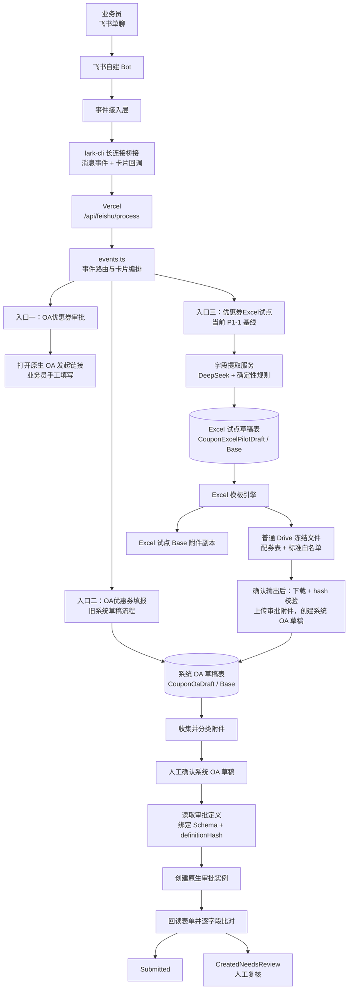
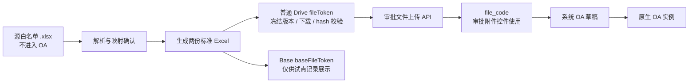

# 优惠券 OA 当前功能结构与重构基线 v1

> **状态**：持续维护的技术基线；用于指导后续迭代与重构拆分
> **版本**：v1.10（与第 12 节变更记录轨道对齐）
> **建立日期**：2026-10-08；最近更新：2026-10-14（补记 ADR-0013 路由放行、OA 草稿存储守卫与已声明取舍）
> **代码快照**：当前工作区中默认关闭的三源 POC 实现；不代表已部署或已获 Gate 批准
> **适用范围**：飞书 Bot、优惠券 Excel 试点、系统 OA 草稿、飞书原生审批提交，以及它们之间的文件与状态交接
> **不替代**：[P1 Excel 试点 PRD v1.5](../product/coupon-oa-p1-excel-pilot-prd-v1.5.md) 的产品范围，也不将[对话式一轮确认改造 PRD](../../proposals/conversational-single-confirm/coupon-oa-conversational-single-confirm-prd-v1.3.md)视为已获批实现。

## 1. 文档目的与使用规则

本文件记录**当前代码已实现的结构**、已验证的运行边界、已知阻塞，以及后续重构的目标和顺序。后续需求、实现与架构决策应以此作为技术对照基线。

### 1.1 文档权威性

| 问题类型 | 以什么为准 |
| --- | --- |
| 当前 P1-1 支持范围、业务字段、验收条件 | [P1 Excel 试点 PRD v1.5](../product/coupon-oa-p1-excel-pilot-prd-v1.5.md) |
| 已写入代码的当前结构、模块职责、已知技术债 | **本文件** |
| 一轮确认交互的目标方案 | [对话式一轮确认改造 PRD](../../proposals/conversational-single-confirm/coupon-oa-conversational-single-confirm-prd-v1.3.md)，获批前不得改变当前基线 |
| OA 权限、确认即提交的平台约束 | [ADR-0004](../../../adr/0004-bot-confirmed-submit-for-coupon-oa.md) |
| 单次环境故障、复测证据 | `operations/diagnostics/` 下对应的日期化诊断文档 |

### 1.2 后续迭代约定

1. 新功能先标注其落点：现有入口、现有状态机、还是新增状态机；不得在没有归属的情况下直接往事件处理器增加分支。
2. 改动用户入口、事实源、审批提交时机、文件归属或责任边界时，先更新本文件；如改变架构边界，另建 ADR。
3. 产品规则变化先修改 PRD；本文件只描述落地结构、迁移策略和技术约束。
4. 每次合并影响结构的代码后，更新第 8 节的模块映射、第 10 节的待办状态和第 12 节的变更记录。

---

## 2. 当前结论

当前系统已具备“**飞书 Bot 采集 → 生成受控 Excel → 系统 OA 草稿 → 原生 OA 提交与回读**”的主要代码能力，但它仍处于 P1-1 内网试点阶段。

- P1-1 的主入口是 `优惠券Excel试点`，支持常规满减券和单列 `SKUID` 白名单。
- 原生 OA 并非可写入的飞书客户端草稿。系统先把待确认数据存入自有的飞书 Base 系统草稿，用户最终确认后才创建原生审批实例。
- Excel 试点生成、普通 Drive 冻结文件写入、Excel 试点 Base 附件写入已实际验证。
- 已知运行阻塞是：确认生成结果后，应用下载 Drive 冻结文件时返回 HTTP 403，导致“Excel 试点 → 系统 OA 草稿”的真实联调尚未完成。详见[Drive 下载 403 诊断](../../records/diagnostics/coupon-excel-pilot-drive-download-403-resolution-2026-09-30.md)。
- 当前已启用/既有路径存在三个入口和两张草稿表；另有默认关闭的三源 adapter 与专用 Base 任务投影。试点期可接受这种并行，但任何一轮确认或耐久化方案获批后，必须先做结构收敛，不能继续向现有总路由叠加分支。
- **三源流程**已有默认关闭的三业务模式适配器：它收集任意布局的配券表、必传 SKU 白名单、可选 SKU 黑名单，以及寄卖/POP 所需的有序测算图片，生成冻结产物并交接现有 OA 测试稿。它与 P1-1/旧草稿路径互斥，使用专用 Base/Drive 配置；当前仅可按[本机长连接 draft-only POC](../operations/coupon-three-source-local-long-connection-poc-runbook-v1.md)验证其受限子集。完整耐久运行时和原生 OA 仍待后续 Gate；不得因代码存在或 POC 成功而启用 native-submit。

### 2.1 三源直接 HTTP POC 的代码边界

三源适配器入口位于 `server/lib/feishu/coupon-oa/three-source/dispatcher.ts`，领域生成在 `server/lib/coupon-oa/three-source/`，而 OA 测试稿交接在 `server/lib/feishu/coupon-oa/three-source/handoff.ts`。它重用既有 OA 草稿与原生提交 Guard，而不重写 native-submit。

作为临时 `local-long-connection-draft-poc`，飞书事件经唯一的本机 `lark-cli` runner 以 HMAC 到达 `server/api/feishu/poc-bridge.post.ts`，再以 `threeSourceOnly` 进入 `handleFeishuPocEvent()`。这仍是同步 legacy POC：文件下载、Excel 解析、标准产物上传与草稿创建都可能发生在同一请求中；本机 runner 甚至可能在 Vercel 成功前 ACK。它没有 durable receipt/outbox、对象存储 canonical bytes、worker、DLQ 或可靠 submission lock，不能替代 [ADR-0007](../../../adr/0007-adopt-durable-control-plane-for-coupon-pilot.md)。

**P0 入口路由放行（2026-10-14，[ADR-0013](../../../adr/0013-p0-bridge-coupon-oa-draft-action-passthrough.md)）**：`threeSourceOnly` 对携带 `draftRecordId` 的恰好三个卡片 action（`coupon_oa_confirm` / `coupon_oa_submit` / `coupon_oa_cancel`）放行至既有 OA 草稿处理链；读取草稿后首先校验 `schemaVersion === COUPON_OA_THREE_SOURCE_PILOT_SCHEMA_VERSION`（`coupon-three-source-pilot-v1`），非三源交接草稿回明确提示卡且零写入。kill switch 保持关闭：提交在 `assertCouponOaNativeSubmitAllowed` 处 fail-closed 回失败卡。第 3 步卡含「放弃本次提交」按钮，`Confirmed` 草稿可由 owner 取消（`isUserCancelableCouponOaDraft`）；`Submitting` 及之后状态仍只能人工对账。

**OA 草稿存储守卫与已声明取舍（2026-10-14）**：`coupon-oa/draft-store.ts` 的 `updateCouponOaDraft` 在每次写入前重读存储记录，校验状态与调用方快照一致且非终态，写入后校验状态落盘；`persistCouponOaSubmissionOutcome` 保证并发方的终态结果不被覆盖，`SubmissionUnknown` 写入前先回读已持久化的 `approvalInstanceCode`（存在则转 `CreatedNeedsReview`，不抹 code）。Base 无 CAS，守卫把并发双提交窗口收窄到单次 Base 往返，残余窗口依赖飞书 `uuid` 幂等性（外部事实，R3 前必须验证）。提交时 `refreshFrozenCouponOaAttachments` 从 Drive 重下载冻结产物、校验 bytes/SHA-256 并重传审批附件库换取新 file code（草稿附件持久化 Drive `fileToken`；无 `fileToken` 的旧路线草稿跳过刷新）。附件 file code 因此在 handoff 与提交时各生成一次，以提交时为准。

功能范围仍刻意受限于常规满减券和 SKU 名单，但本地代码现支持 `严选`、`寄卖`、`pop`。严选不冻结 `calcImage`；寄卖/POP 优先冻结 owner 确认的有序用户图片，没有用户图片时从最终标准配券工作簿显示值生成分页 PNG。图片和 Excel 都需在交接前从 Drive 回读并校验 bytes/hash。完整边界与运行步骤见[本机长连接 draft-only POC 运行手册](../operations/coupon-three-source-local-long-connection-poc-runbook-v1.md)。

三源商品白名单与可选黑名单按源工作簿的有效 Sheet 动态处理，不再要求固定
五个券档 Sheet 名。每个生成 Sheet 保留源名称、相对顺序和 SKU 行顺序，但标准
产物只包含一列文本格式 `sku`，不复制源表其他列、公式或关系。同一 Sheet 内的
重复 SKU 按首次出现位置去重，不阻断生成；同一 SKU 出现在不同 Sheet 时分别
保留，不能用跨 Sheet 的全局集合过滤。DeepSeek 可识别名单区域和券档候选，
服务端仍负责坐标、SKU、安全和 revision 校验；源名单不会直接成为 OA 附件。

---

## 3. 系统全景结构



### 3.1 运行时事件链路

> **代码快照边界**：下列链路只描述本文件固定的 `45ae50f` 本地开发/旧 POC 路径，不是 R1 企业托管 bridge 的部署方案。即使把该脚本复制到企业主机，也不会因此满足 ADR-0006 要求的专用 HMAC、持久 outbox/receipt、稳定 ID 去重、单活、supervisor、监控或恢复门禁。R1 资源发现与部署前交接必须遵循[资源发现与部署前交接指南](../operations/coupon-oa-managed-bridge-provisioning-guide-v1.md)、[bridge 设计](coupon-oa-managed-bridge-design-v1.md)和[readiness checklist](../operations/coupon-oa-pilot-launch-readiness-checklist-v1.md)。

```text
飞书消息 / 卡片回调
  → lark-cli event consume（本地 WebSocket）
  → POST /api/feishu/process（Vercel）
  → handleFeishuPocEvent()
  → 相应流程服务
  → 飞书消息 API 回发交互卡片
```

- 桥接消费 `im.message.receive_v1` 与 `card.action.trigger`，实现位于 [`scripts/long-connection-bridge.mjs`](../../../../scripts/long-connection-bridge.mjs)。
- HTTP 入口位于 [`server/api/feishu/process.post.ts`](../../../../server/api/feishu/process.post.ts)。
- 事件总路由位于 [`server/lib/feishu/events.ts`](../../../../server/lib/feishu/events.ts)。
- 飞书 API 调用统一通过应用身份的 `tenant_access_token`；凭证只应保存在服务器环境变量中。
- `local-long-connection-draft-poc` 例外保持飞书长连接，经本机唯一 runner 的 HMAC 请求进入 `/api/feishu/poc-bridge`。该入口只在 `local` stage 接受验证请求，并以 `threeSourceOnly` 限制到 P0 adapter（[ADR-0013](../../../adr/0013-p0-bridge-coupon-oa-draft-action-passthrough.md) 放行的三个 OA 草稿 action 除外）；它不能证明 ACK、retry 或恢复，详见[运行手册](../operations/coupon-three-source-local-long-connection-poc-runbook-v1.md)。

> 本地长连接进程只能用于开发诊断。R1 证据必须绑定企业托管宿主、固定 Git revision/artifact、受签名 ingress、持久接收和运行证据；Vercel 服务健康不等于 Bot WebSocket 消费正常，也不等于企业 bridge 已就绪。

---

## 4. 三个用户入口与默认关闭的三源适配器

| 入口口令 | 当前定位 | 是否创建系统草稿 | 是否创建原生 OA | 后续处理建议 |
| --- | --- | --- | --- | --- |
| `OA优惠券审批` | 手工兜底入口，仅打开配置的原生 OA 发起链接 | 否 | 用户在飞书页面手工提交 | 保留为兜底，不作为自动化主线 |
| `OA优惠券填报` / `优惠券提单草稿` | 较早的 Bot 表单 + 系统 OA 草稿流程 | 是 | 草稿确认后可提交 | 逐步吸收为统一任务的“手工材料路径” |
| `优惠券Excel试点` | 当前 P1-1 主线：生成标准 Excel 后交接到 OA 草稿 | 是，先经 Excel 试点草稿 | 通过系统 OA 草稿链路提交 | 保持当前基线，作为后续统一任务的“Excel 生成路径” |
| `/OA优惠券提报` | 默认关闭的三业务模式三源适配器 | 是，专用三源 Base 投影后交接 OA 测试稿；交接后可进入 OA 草稿确认页（ADR-0013 路由放行） | `local-long-connection-draft-poc` 中禁止原生 OA（kill switch 关闭，提交 fail-closed） | 仅限单用户测试；三业务模式和测算图需另行部署与真实环境验收 |
| `/clear` | P0 三源失败恢复口令 | 不创建新草稿；把 owner 的活动三源任务标记为 `Canceled` | 否 | 保留 Base/Drive 审计记录，清空后必须重新上传材料 |

每位业务员同一时刻不允许同时存在活动的 Excel 试点、系统 OA 草稿和三源任务；三源试点只查询已启用且存储配置完整的既有路线来执行冲突检查，避免未启用路线因缺少 Base 配置而阻断 P0。已配置路线仍保持互斥，以避免文件被错误归属到另一条流程。

---

## 5. 当前主流程

### 5.1 Excel 试点 → 系统 OA 草稿 → 原生 OA

```text
1. 业务员发送「优惠券Excel试点」
2. 系统创建 Excel 试点草稿，收集活动与券档字段
3. AI 提取候选字段；规则代码校验格式、金额、日期、枚举与业务约束
4. 业务员确认字段，上传源白名单 .xlsx
5. 系统解析 Sheet/列候选，业务员确认 SKU 来源列
6. 系统生成两份 Excel：配券信息表、标准 SKUID 白名单
7. 两份文件上传至普通 Drive 冻结，并写入 Excel 试点 Base 附件字段
8. 业务员确认生成结果
9. 系统重新从 Drive 下载冻结文件，校验字节数和 SHA-256
10. 系统将两份冻结文件上传至审批附件库，得到 file_code
11. 系统创建 CouponOaDraft，并写入 OA 字段与两个 file_code
12. 寄卖 / pop 场景由业务员补齐满减测算图片
13. 业务员确认系统 OA 草稿
14. 系统重新读取审批定义，definitionHash 一致时创建原生 OA 实例
15. 系统回读原生 OA 表单；一致则 Submitted，不一致则 CreatedNeedsReview
```

### 5.2 文件身份与安全边界



| 文件标识 | 来源 | 唯一用途 | 不可替代原因 |
| --- | --- | --- | --- |
| `fileToken` | 普通 Drive 文件夹 | 冻结文件、重新下载、hash 校验、提升为审批附件；派生卡内 👁 预览链接 | 是确认后文件完整性校验的依据 |
| `baseFileToken` | `bitable_file` 附件上传 | Excel 试点 Base 记录中的附件可见性 | 普通 Drive token 不能直接写入 Base 附件字段 |
| `file_code` | 审批附件上传 API | 原生 OA `attachmentV2` / `image` 控件赋值 | 不是 Drive 或 Base 文件 token |

**硬边界：**源白名单只用于输入解析，绝不直接写入审批附件；只有确认后的两份生成文件可进入 OA 附件链路。

**卡内预览入口（三源流程）：**三源确认卡可为每个冻结产物渲染一个 `👁 预览` 按钮，点击在飞书客户端内打开 `{FEISHU_WEB_BASE_URL}/file/{fileToken}` 的原生文件预览。上传成功后服务端以 `type=file` 协作者接口给提报发起人授 `view` 权限（`drive-client.ts` 的 `grantFeishuDriveFileViewPermission`，1063003 时回读成员表确认后才视为已授权）；授权结果记入产物元数据 `previewGrantedFor` / `previewGrantError`。该入口是辅助能力：授权失败、`FEISHU_WEB_BASE_URL` 未配置或应用未发布协作者授权权限时，卡片自动退回纯文件列表，不阻塞冻结、确认与 OA 测试稿交接，也不得因此扩大 Drive 权限。

---

## 6. 两套状态机

### 6.1 Excel 试点草稿

```text
Collecting
  → AwaitingInputConfirmation
  → AwaitingWhitelistUpload
  → AwaitingWhitelistMapping
  → Generating
  → AwaitingOutputConfirmation
  → HandingOffToOa
  → GeneratedConfirmed

任意可编辑阶段
  ├─ 字段/文件/规则问题 → NeedsInput
  ├─ 临时外部失败 → RetryableFailure
  └─ 业务员取消或空闲超时 → Canceled
```

Excel 试点草稿保存以下事实：已确认输入、源文件 hash、来源 Sheet/列、生成 revision、两份产物 hash、Drive token、Base 附件 token、OA 交接结果和失败原因。

### 6.2 系统 OA 草稿

```text
Draft
  → Validated
  → Confirmed
  → Submitting
  ├─ Submitted
  ├─ CreatedNeedsReview
  └─ Failed

Draft / Validated / Failed
  └─ 业务员取消或空闲超时 → Canceled
```

系统 OA 草稿保存最终 OA 字段、审批附件 `file_code`、确认时间、审批定义 hash、原生实例编号、实例链接和回读差异。

### 6.3 原生 OA 提交守卫

```text
Confirmed 系统草稿
  → 读取最新审批定义
  → 绑定控件名称 + 类型
  → 比较 definitionHash
      ├─ 不一致：阻断，要求重新确认
      └─ 一致：编码表单并使用确定性 uuid 创建实例
  → 保存 instance_code
  → 回读实例
      ├─ 一致：Submitted
      └─ 差异 / 回读异常：CreatedNeedsReview
```

飞书开放平台不存在“创建客户端 OA 草稿”的官方 API；因此调用 `POST /approval/v4/instances` 即产生真实审批实例，必须只发生在用户最终确认之后。

---

## 7. 当前事实源与外部依赖

| 层 | 事实源 / 服务 | 当前职责 | 边界 |
| --- | --- | --- | --- |
| 飞书消息 | IM 消息、卡片事件 | 用户输入、附件事件、确认动作 | 原始输入不直接作为 OA 字段事实 |
| Excel 试点 Base | 独立试点表 | 记录输入、映射、生成物、revision、交接状态 | 不复用 OA 草稿表 |
| 普通 Drive | 应用管理的文件夹 | 保存两份冻结 Excel；三源流程额外为发起人授权只读预览 | 必须保留下载与 hash 校验能力；预览授权失败时降级隐藏入口，不得阻塞主流程 |
| 系统 OA 草稿 Base | 独立 OA 草稿表 | 可恢复的业务草稿、审批附件引用、审计状态 | 不是飞书客户端草稿箱 |
| 飞书审批定义 | `approval_code` 对应定义 | 控件绑定、审批路由、公式计算 | 定义变化时 fail-closed |
| 飞书原生 OA | 审批实例 API | 真正提交、审批、流转 | 系统不覆盖审批人、抄送人或路由 |
| DeepSeek | 字段提取辅助服务 | 从业务文本提取候选字段与歧义 | 不能决定规则、模板、附件或提交 |

---

## 8. 当前代码模块地图

| 模块 | 主要职责 | 后续定位 |
| --- | --- | --- |
| `server/lib/feishu/events.ts` | 事件解析、入口路由、卡片回调、流程编排 | **应瘦身为 transport / dispatcher** |
| `coupon-oa/excel-pilot-service.ts` | 字段提取、白名单处理、生成产物 | 保留为 Excel 生成应用服务 |
| `coupon-oa/excel-pilot-store.ts` | Excel 试点草稿读写与 revision | 逐步实现 repository 接口 |
| `coupon-oa/excel-pilot-oa-handoff.ts` | 冻结文件校验、审批附件提升、创建 OA 草稿 | 保留为明确的 handoff application service |
| `coupon-oa/draft-service.ts` | 系统 OA 草稿字段校验、附件分类与绑定 | 保留，后续收敛为领域策略 |
| `coupon-oa/draft-store.ts` | 系统 OA 草稿读写 | 逐步实现 repository 接口 |
| `coupon-oa/approval-schema.ts` | 审批定义绑定、表单编码与回读比对 | **核心安全边界，优先保留** |
| `coupon-oa/approval-client.ts` | 审批定义、附件、实例的飞书 API 封装 | 保留为 Feishu Approval Gateway |
| `coupon-oa/submit-service.ts` | 确认、提交、回读止损 | 保留为原生审批提交应用服务 |
| `excel-template-engine/` | 模板读取、生成与二次校验 | 保持独立，禁止被卡片层直接调用 |
| `coupon-oa/three-source/` | 三源识别、SKU 名单校验、canonical revision、标准产物、测算图校验/渲染与 OA 预填 | 本地支持严选/寄卖/POP；非 SKU 与原生 OA 仍未开放 |
| `coupon-oa/three-source/dispatcher.ts` | 精确命令、材料、卡片回调、跨流程互斥与 OA 测试稿路由 | 默认关闭；只可在本机长连接 draft-only POC 中测试，不能承担 R2/R3 ingress |
| `coupon-oa/three-source/store.ts` | 三源 pilot Base 状态和 revision 投影 | 临时 POC 存储；不是事务事实源或提交锁 |
| `coupon-oa/three-source/handoff.ts` | 冻结产物复验、审批附件提升和既有 OA 草稿创建 | 复用既有草稿安全边界；不直接创建原生 OA |
| `base-store.ts` | 通用报销 POC 的模板与实例 | 应与优惠券 OA 域隔离，避免继续混入 `events.ts` |

---

## 9. 重构判断与目标结构

### 9.1 当前结构的主要技术债

| 问题 | 当前表现 | 风险 | 重构方向 |
| --- | --- | --- | --- |
| 三个并行入口 | 手工入口、旧草稿入口、Excel 试点入口同时存在 | 用户与维护者难以判断唯一主路径 | 将来收敛为“优惠券提单”一个入口，按条件进入 Excel 生成子阶段 |
| 两套草稿状态机 | Excel 试点草稿交接至系统 OA 草稿 | 状态、超时、取消、owner 校验容易重复实现 | 建立统一顶层 `CouponTask`，保留 Excel 为子流程 |
| 总路由过重 | `events.ts` 同时处理报销 POC、优惠券、附件、状态机、卡片 | 新功能靠增加 if/else，回归范围扩大 | 拆为 transport、command dispatcher、application service |
| Base 更新无真正 CAS | revision 在本地对象中比较后再 PUT | 并发请求可能覆盖同一 revision | 增加服务端锁、条件更新或不可变事件记录 |
| 读取活跃草稿方式粗粒度 | 从 Base 拉取记录后在应用层按 owner 过滤 | 规模扩大后会漏页、效率与数据暴露面变差 | 增加可查询索引 / 分页 / 按 owner 的 repository 查询 |
| 同步长任务 | 文件下载、解析、生成、上传在事件处理链中执行 | 超时、重试和重复事件处理复杂 | 试点后视耗时与并发引入任务队列 / outbox |

### 9.2 不建议重构的核心能力

以下能力已经承担安全职责，应在重构时保留并以测试保护，而不是重新设计：

1. 源白名单不进入 OA 附件；
2. 生成文件冻结后必须下载并校验大小与 SHA-256；
3. 审批定义绑定与 `definitionHash` fail-closed；
4. 原生 OA 创建后必须回读比对；
5. 确认前不创建原生 OA；
6. 申请人以最终业务员 `open_id` 为准，系统不篡改审批人或抄送人。

### 9.3 目标结构（获批一轮确认后）

```text
Feishu transport
  → CouponCommandDispatcher
  → CouponTaskApplicationService
      ├─ Start / Resume Task
      ├─ Collect Input
      ├─ Handle Source Files
      ├─ Generate Excel (when needed)
      ├─ Build Final Confirmation
      └─ Submit Native Approval
  → CouponTask domain aggregate
      ├─ owner / revision / lifecycle
      ├─ canonical business input
      ├─ generated artifacts
      ├─ required attachments
      ├─ confirmation snapshot
      └─ native approval result
  → repositories / gateways
      ├─ Base task repository
      ├─ Drive gateway
      ├─ Approval gateway
      ├─ Excel generator
      └─ AI extraction gateway
```

目标不是立刻删除 Excel 草稿表，而是先让它成为统一 `CouponTask` 的一个可替换实现或子状态；待历史试点记录稳定、迁移方案明确后再收敛存储。

---

## 10. 建议迭代顺序

### P0：当前试点上线前必须完成

- [ ] 在飞书开放平台补齐并发布 Drive 读取 / 下载权限，解决冻结文件下载 403。
- [ ] 用脱敏样本完成“Excel 生成 → 审批附件上传 → 系统 OA 草稿”的真实联调；测试必须停在最终原生 OA 提交按钮前。
- [ ] 明确 Bot 事件入口的常驻运维方案，监控桥接进程、Vercel 服务和飞书 API 失败。
- [ ] 为关键状态转移补足真正的并发控制；不能只依赖卡片上的 revision。
- [ ] 修复工程验证入口，使测试和 lint 忽略 `.claude/worktrees/` 等嵌套工作目录。

### P1：不改变当前产品行为的结构重构

- [ ] 将 `events.ts` 拆为事件适配层、命令分发层和优惠券 application services。
- [ ] 抽出 `CouponWorkflowRepository`、`ApprovalGateway`、`DriveGateway` 等接口，保留现有 Base / 飞书实现作为适配器。
- [ ] 将 owner、revision、空闲超时、幂等键和状态守卫提炼为共享领域策略。
- [ ] 将通用报销 POC 从优惠券 OA 事件编排中隔离。
- [ ] 对每个外部副作用建立可恢复记录：计划 → 执行 → 回读确认 → 失败处理。

### P2：一轮确认方案获批后再做

- [ ] 建立唯一的“优惠券提单”用户入口。
- [ ] 建立统一顶层 `CouponTask`，Excel 生成成为可选子阶段。
- [ ] 将正常路径收敛为“发起 → 补齐输入和材料 → 一张最终确认单 → 发起原生 OA”。
- [ ] 设计旧 Excel 试点草稿与旧 OA 草稿的兼容读取和渐进迁移，不删除历史审计数据。

### P3：试点扩容后按数据决定

- [ ] 引入异步任务队列、租约、恢复器和可观测性指标。
- [ ] 将 Base 从高频工作流状态存储迁移为更适合并发与查询的持久化层；Base 可继续作为运营视图或审计镜像。
- [ ] 制定源文件、冻结产物、审批附件元数据的保留与清理策略。

---

## 11. 重构验收标准

后续任何重构完成前，至少应证明以下内容不回退：

1. 正常 P1-1 业务员仍可完成字段采集、白名单映射、两份 Excel 生成和确认。
2. 源白名单始终不会进入审批附件。
3. 两份进入审批附件库的文件必须能追溯到同一冻结 revision，并通过 hash 校验。
4. 旧卡片、重复回调、跨设备并发和超时重试不会生成重复附件或重复 OA。
5. 审批定义变化后，未重新确认的草稿不得创建原生 OA。
6. 原生 OA 创建后必定保存实例编号，并进行回读；回读异常不得标记为成功。
7. 每一笔草稿与原生 OA 都可定位 owner、revision、确认人、确认时间、文件 hash、审批定义 hash 和实例结果。
8. `pnpm test`、服务端类型检查、lint 及新增的端到端脱敏演练均可稳定执行。

---

## 12. 变更记录

### 12.1 P0 DeepSeek 候选识别增量（默认关闭）

三源 P0 已增加以下代码边界，但不代表部署环境已启用或完成真实联调：

- `ai-recognition.ts` 将整本工作簿的非空单元格序列化为一次请求，公式只作为标记数据，不执行；严格 schema 和来源坐标校验后才形成候选。
- `deepseek-chat-gateway.ts` 只访问官方 HTTPS endpoint，设置超时与 1 MiB 响应上限，对上下文拒绝、429、超时、网络、无效 JSON 和超大响应分类；密钥不进入错误或审计。
- 上传阶段仅保存确定性识别结果；owner 点击“材料已上传完毕，开始统一识别”后，服务端先准备 AI run，再把整批 run ID/pending 状态写入 Base，最后幂等激活 durable effect，避免 effect 早于草稿状态执行。
- `coupon_ai_recognition_runs` 与 durable effect 用语义键限制每个 source/revision/model/prompt version 一次外发。终态先持久化，再投影 Base/Card；投影重试不得再次调用 DeepSeek。同一业务任务的 AI effect 串行投影，不同任务仍可并行，防止 Base 全量 JSON 回写发生 lost update。
- `coupon_ai_text_runs` 使用 owner/revision/text hash/model/prompt version 形成独立语义键。业务员检查过的语音转写或文字只用于字段候选提取；终态先持久化再回填第二轮卡，投影重试不得再次外发。原文不得进入日志、附件或 OA。
- 同一批来源进入 AI 识别时只追加一张处理中卡片；单个来源识别完成但仍有其他来源 pending 时不再发中间卡。整批终态后创建且仅创建一条汇总第二轮卡片消息，持久保存其 `message_id`；无黑名单、超扣选择和补充说明识别等后续状态变化通过飞书消息卡片 PATCH 更新同一条消息，不再追加重复的第二轮卡片。
- Base P0 draft 只保存结构化候选、审计摘要和 owner 选择。owner、revision 或 source hash 变化时丢弃旧投影。
- 第二轮按券模板而不是满减金额行判断歧义；同一常规满减模板中的多行作为多券档生成。缺字段记录 `ownerSupplement` provenance，覆盖非空源值必须附原因。活动点位不能从优惠比例推导。
- 已登记白名单 Sheet 名自动映射到对应券档并保留多 Sheet 输出；生成器校验原模板 SHA-256，写入文本 SKU 后重新打开校验。
- 卡片业务字段使用中文标签，业务模式提供“严选 / 寄卖 / POP”选择；补充说明使用可编辑多行文本框，兼容系统输入法语音转写。DeepSeek 可提出活动名称/背景候选，已验证候选回填为可编辑默认值；补充说明识别只填补空白字段，不覆盖 owner 已填写的非空值。卡片显示中文的 DeepSeek 成功、处理中或降级状态，但不显示 prompt、坐标、响应体或敏感标识。确定性模板引擎只消费 owner 最终确认值。
- AI-primary 开启时，`ai-recognition.ts` 的完整语义候选优先于表头别名；服务端逐项校验证据坐标、来源 hash、模板和券档。规则识别仅补足 AI 缺项。多行满减和多 Sheet 名单均属于同一模板的多个券档，不再显示技术列/Sheet 选择器。
- 活动文案使用版本化合同：名称遵循“活动周期 + 业务模式 + 商品或活动主题 + 优惠券申请”，背景遵循“本期申请……，本期配置 N 档优惠券：全部券档；配合已证实主题或说明”。服务端校验占位名称、结构、全部券档覆盖和禁止编造事实；文案开关关闭时不得将 AI 文案投影到卡片。owner 已修改的值优先于任何 AI 或规则候选。
- 无年份月日可生成标记为 `ai_inferred` 的完整日期候选。公共日历 gateway 默认关闭，只接收月日窗口、`zh-CN` 和查询版本；其候选与工作簿一起进入同一次 durable recognition 外发。日历失败安全降级，识别终态投影重试不再查询日历或外发工作簿。

该增量由 [ADR-0011](../../../adr/0011-use-deepseek-only-for-p0-candidate-recognition.md) 和 [ADR-0012](../../../adr/0012-make-ai-primary-for-p0-three-source-recognition.md) 约束。所有 AI-primary、文案和公共日历开关默认 `false`；AI 关闭或失败时保留确定性识别和 owner 人工补充路径。它不改变 `FEISHU_COUPON_OA_NATIVE_SUBMIT_ENABLED=false`、源文件不得进入 OA 附件或 P0 单用户限制。

| 日期 | 版本 | 变更 | 责任说明 |
| --- | --- | --- | --- |
| 2026-10-14 | v1.10 | 本地测试轮驱动的第二轮卡 UX 与链路收敛：超扣改表单内下拉（去 PATCH 刷新）、补充说明改选填、生成确认后卡片立即变"生成中"防连点、提交先中文预校验再推版本（缺项原地可重试，格式错误仍走 AI 修复）、日期输入常驻表单；生成失败自动回退 GeneratingArtifacts 并重发表单（`recoverFailedGeneration`）；试点链第 5 步确认后直达「第 6 步提交确认卡」（去掉中间预填确认），已完成提报旧卡重击幂等重发该卡；**确认身份降级为尽力而为**（空壳通讯录档案/部门歧义 → openId-only 快照，表单省略身份控件，实例申请人仍由 create 请求的 open_id 指定） | 代码在工作区、自动化用例全过；尚未部署。**canary 前验证项**：目标定义的「部门」「申请人」控件为 required=true——开 Gate 后需验证飞书对省略的必填身份控件是自动填充还是拒绝；若拒绝则补 `contact:user.base:readonly` + `contact:user.department:readonly` 并发布应用版本（代码将自动恢复全量身份快照），失败为干净拒绝无副作用 |
| 2026-10-14 | v1.9 | 补记 [ADR-0013](../../../adr/0013-p0-bridge-coupon-oa-draft-action-passthrough.md) P0 入口路由放行（三个 OA 草稿 action + schemaVersion 守卫）；OA 草稿 store 写前回读守卫、`persistCouponOaSubmissionOutcome` 终态不被并发覆盖、SubmissionUnknown 不抹已持久化实例 code、提交时冻结产物重验重传换新 file code 与已声明取舍 | 代码在工作区、自动化用例全过；尚未部署，待 ADR-0013 Owner 追认与本地/Preview 测试轮 |
| 2026-10-12 | v1.8 | AI-primary 工作簿合同升级为 v5、活动文案合同升级为 v3；补齐多渠道和日期标准化、同 Sheet 分段 SKU 区域、错误尾行收敛与不支持券型结构化阻断 | 已通过本地单元、集成和 6 组脱敏 Excel + DeepSeek 预检；仍须在单用户 Preview 完成飞书 E2E，不表示生产上线 |
| 2026-10-12 | v1.7 | 第二轮卡片改为单消息原位更新；修复补充说明空白字段回填，并启用 AI-primary v2 活动文案候选合同 | 当前仅代码与本地测试；部署后仍需单用户 Preview E2E，不表示能力已上线 |
| 2026-10-12 | v1.6 | 增加默认关闭的 AI-primary 证据合同、活动文案校验、无年份推测和公共日历软证据 | 当前仅代码与本地测试；不表示 Preview 已配置、飞书 E2E 已通过或能力已上线 |
| 2026-10-11 | v1.5 | 多券档、多 Sheet 名单、中文第二轮卡与耐久补充说明识别 | 仍限常规满减、draft-only；寄卖/POP 生成 Gate 仍按当前能力拒绝 |
| 2026-10-11 | v1.4 | 增加显式“上传完成”批量识别、prepare→Base→activate 顺序与同任务串行投影；无黑名单确认并入汇总第二轮 | 修复并发 AI 投影覆盖导致 pending 无 effect、无法返回第二轮卡的问题 |
| 2026-10-11 | v1.3 | 收敛多来源上传与 AI 终态投影的中间卡片，避免每个来源各追加一张“AI 识别中” | 保留每条来源消息与 AI run 的耐久幂等；仅收敛用户可见状态卡 |
| 2026-10-10 | v1.2 | 增加默认关闭的 P0 DeepSeek 候选识别、第二轮单券确认、单 Sheet 名单生成与 durable effect 边界 | 代码完成本地验证；仍待外部 P0 验证 |
| 2026-10-10 | v1.1 | 记录默认关闭的严选三源适配器及直接 HTTP draft-only POC 边界；明确它不满足耐久或 native-submit Gate | 基于当前 server 三源实现和 ADR-0009 更新 |
| 2026-10-08 | v1.0 | 首次建立当前功能结构、状态机、文件边界、技术债与分阶段重构基线 | 基于 `main` 的已实现代码和已有诊断记录整理 |
